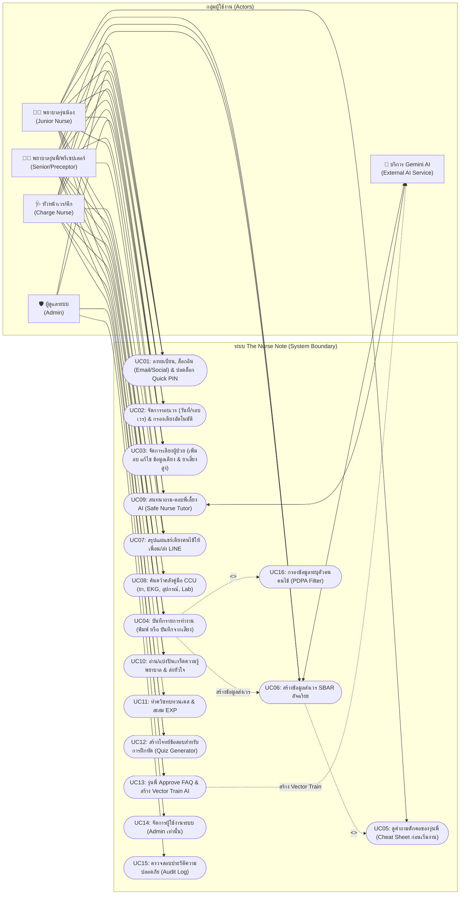

# แผนภาพยูสเคส (Use Case Diagram)
## โครงการ: The Nurse Note (เพื่อนคู่คิดและพี่เลี้ยงพยาบาลอัจฉริยะ)

เอกสารนี้แสดงขอบเขตปฏิสัมพันธ์ระหว่างผู้ใช้งานกลุ่มต่างๆ (Actors) กับฟังก์ชันการทำงานหลักของระบบ The Nurse Note ภายใต้การควบคุมสิทธิ์ (RBAC) และการคุ้มครองข้อมูลส่วนบุคคล (PDPA)

---

### 1. แผนภาพ Use Case Diagram (Mermaid Graph)

---

### 2. คำอธิบายสาระสำคัญของ Use Case

| รหัส Use Case | ชื่อ Use Case | ผู้ใช้งานหลัก | คำอธิบายสาระสำคัญ |
| :--- | :--- | :--- | :--- |
| **UC01** | ลงทะเบียน, ล็อกอิน (Email/Social) & ปลดล็อก Quick PIN | ทุกคน | ลงทะเบียนพร้อมตั้งและยืนยัน Quick PIN 4 หลัก, ยืนยันตัวตนด้วยอีเมล/รหัสผ่าน หรือ Google Sign-In, ผูกอุปกรณ์ส่วนตัวพยาบาล (Device Binding) ป้องกันล็อกอินซ้อน และปลดล็อกด่วนกรณีล็อกจออัตโนมัติ 5 นาที |
| **UC02** | จัดการรอบเวร & กรองเตียงอัตโนมัติ | JN, SN, CN | จัดการวันที่และปุ่มรอบเวร (เช้า/บ่าย/ดึก) แบบแถวเดียว และกรองรายการเตียงอัตโนมัติตามเวร |
| **UC03** | จัดการเตียงผู้ป่วย (CRUD) | JN, SN, CN | แสดงจำนวนเตียงรวม, ปุ่มไอคอน "+" เพิ่มเตียง, แก้ไข และลบข้อมูลเตียงผู้ป่วยในเวร |
| **UC04** | บันทึกรายการทำงาน (พิมพ์/เสียง) | JN, SN, CN | บันทึกกิจกรรมการพยาบาลแบบรายการตามเวลา มีกล่องป้อนงานแบบ Toggle และรองรับการพูดถอดความจากเสียง |
| **UC05** | ดูคำถามดักคอของรุ่นพี่ (Cheat Sheet) | JN, SN | แสดงโพยคำถามดักคอที่รุ่นพี่/แพทย์มักจะถามจี้ไว้บนสุดของหน้าการทำงาน ให้น้องเตรียมตัวล่วงหน้า |
| **UC06** | สร้างข้อมูลส่งเวร SBAR อัจฉริยะ | JN, SN, AI | ประมวลผลจากรายการทำงานและข้อมูลผู้ป่วย แปลงเป็นข้อความ SBAR ที่ถูกต้องตามมาตรฐานวิชาชีพ |
| **UC07** | แชร์เตียงคนไข้ให้เพื่อน/ส่ง LINE | JN, SN, CN | จัดฟอร์แมตสรุปข้อมูลเตียงใน 1 คลิก ส่งต่อเพื่อนร่วมเวรหรือกลุ่ม LINE ปลอดภัยตาม PDPA |
| **UC08** | ค้นคว้าคลังคู่มือ CCU | JN, SN | คลังเอกสารแบ่งหมวดหมู่: ยาเสี่ยงสูง, แถบ EKG, อุปกรณ์ช่วยชีวิต, และผลตรวจทางห้องปฏิบัติการ |
| **UC09** | ถามพี่เลี้ยง AI (Safe Nurse Tutor) | JN, SN, AI | สนทนาถาม-ตอบข้อสงสัยการพยาบาล 24 ชม. ไม่ดุ ไม่ด่า มีเหตุผลทางคลินิกรองรับ |
| **UC10** | อ่าน/แบ่งปันเกร็ดความรู้พยาบาล | ทุกคน | บอร์ดแลกเปลี่ยนทริคจากรุ่นพี่ พร้อมปุ่มส่งหัวใจแสดงความขอบคุณ (Heart Reaction) |
| **UC11** | เล่นเกมควิซ & สะสม EXP | JN, SN | ฝึกตอบคำถามจำลองสถานการณ์ส่งเวร เพิ่มความมั่นใจและเลเวลพยาบาล |
| **UC12** | สร้างโจทย์ข้อสอบฝึกหัด (Quiz Generator) | SN, CN, AD | ออกข้อสอบเคสใหม่เพื่อกระจายให้พยาบาลทุกคนในวอร์ดได้ฝึกทำ |
| **UC13** | รุ่นพี่ Approve FAQ & Vector Train AI | SN, CN | ตรวจสอบรับรองคำตอบ FAQ และสั่งสร้าง Vector Embeddings เข้าโมเดล AI ติวเตอร์ทันที |
| **UC14** | จัดการผู้ใช้งานระบบ (User Management) | AD | จัดการบัญชีพยาบาล ตรวจสอบสถานะการผูกอุปกรณ์ และสิทธิ์ในระบบ (เฉพาะ Admin) |
| **UC15** | ตรวจสอบประวัติความปลอดภัย (Audit Log) | AD | ตรวจสอบประวัติการเข้าใช้งานตามข้อกำหนด พ.ร.บ. คุ้มครองข้อมูลส่วนบุคคล |
| **UC16** | กรองข้อมูลระบุตัวตนคนไข้ (PDPA Filter) | ระบบอัตโนมัติ | กรองชื่อ-นามสกุล, เลขประจำตัวประชาชน และ HN ออกก่อนส่งให้ AI ภายนอก |
